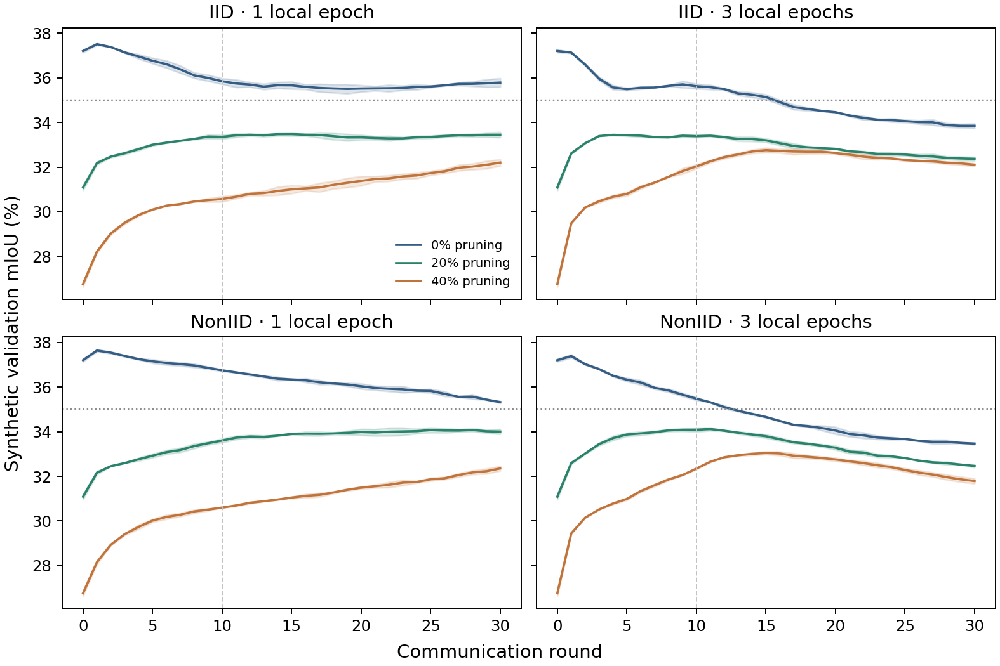
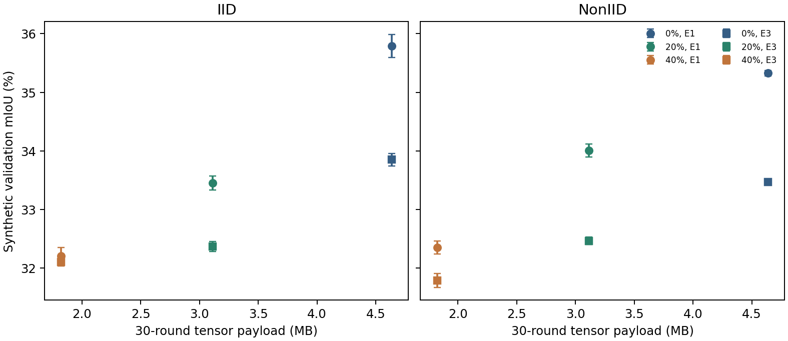
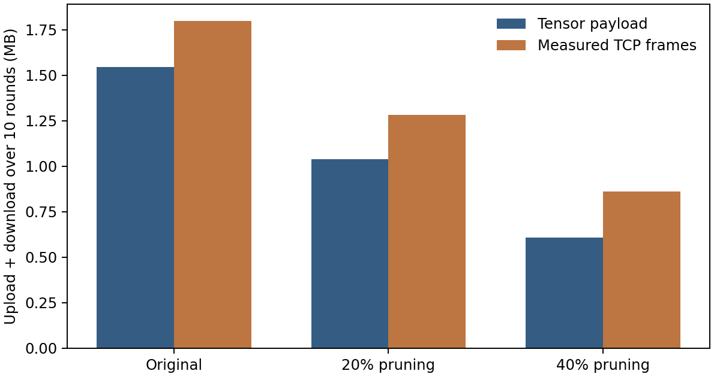

# 구조적 프루닝과 2-client 연합학습

## 연구 질문과 조건

두 클라이언트가 같은 폭의 경량 sparse 3D CNN을 교환할 때 채널 축소가 전송 바이트, 수렴과 Non-IID 안정성에 주는 영향을 측정했다. 주평가지표는 고정 Synthetic validation의 점유 복셀 mIoU다. 모든 ± 값은 같은 분할에서 실행한 세 시드(42·43·44)의 평균과 표본 표준편차다.

NVIDIA RTX A6000 한 장과 PyTorch 2.8.0+cu126를 사용했다. RGB-16, 0.3 m Full-Z XY 32×32, 7점 submanifold convolution, encoder/pool/bridge/skip decoder, BN, 6개 클래스를 기존 구현에서 재사용했다. 이전 Synthetic 장면 13 전체 35 epoch 중 장면 12 검증으로 선택한 32 epoch 기준 체크포인트를 공통 출발점으로 삼았다. 이전 0·20·40% 체크포인트의 해시와 구조, 불균등 샘플 수 1:3에서 FedAvg의 수치 결과를 점검했다. 원본 모델의 seed 42, Non-IID, E1 smoke를 10라운드 완료한 뒤 본실험을 시작했다.

프루닝은 각 블록의 출력 필터 L1 순위로 실제 채널을 제거하고 BN, 다음 입력, coarse/skip 인덱스와 head를 함께 줄였다. 같은 출발점에서 구조를 만든 뒤 세 모델 모두 장면 13의 동일한 192패치로 5 epoch 미세조정했다. 마지막 epoch를 사용했다. 이전 실험에서 각자 다른 epoch로 선택한 미세조정 모델을 새 비교에 그대로 쓰지 않았다. 시드는 미세조정·로컬 배치 순서에 적용된다. 사전학습 자체를 독립적으로 세 번 반복한 실험은 아니다.

|요청 채널 축소|실제 폭|파라미터|상태 텐서 bytes|체크포인트 bytes|검증 24패치 MACs|
|---|---|---|---|---|---|
|0%|(16, 32, 16)|9,526|38,640|44,301|193,966,288|
|20%|(13, 26, 13)|6,376|25,944|31,911|130,129,714|
|40%|(10, 19, 10)|3,714|15,192|21,415|76,450,950|

## 고정 데이터 분할

하나의 GPU에서 전체 요인 조합을 비교할 수 있도록 FL은 장면 3·4에서 각각 96패치, 라운드 검증은 장면 12에서 144패치를 고정했다. 각 장면 안에서 지배 클래스 비율에 맞춰 시드 2026으로 추출했다. 원본 각 장면에는 2,704패치가 있다. 장면 13은 사전학습·미세조정 전용이고, 장면 12는 공통 검증 전용이다. 두 조건의 클라이언트 합집합과 패치 방문 수가 같고 한 조건 내 중복 패치는 0이다. 장면 12 전체 4,226,451복셀에 대한 별도 종점 점수도 집계했다. 장면 12는 종전 사전학습 모델 선택에도 사용되었다.

Non-IID는 Drone 1에 장면 3, Drone 2에 장면 4를 배정했다. IID 근사는 두 클라이언트가 각 장면에서 48패치씩 받게 하고 고정 후보 배정 중 여섯 클래스의 점유 빈도 차이가 가장 작은 것을 선택했다. 이 조건은 같은 장면의 인접 타일이 서로 다른 클라이언트에 들어갈 수 있다. 별도 장면 12와 WMSC 패치는 어떤 클라이언트 학습에도 들어가지 않는다. [실제 패치 ID](split.json) · [클래스별 복셀 수](client_distributions.csv)

|분할|클라이언트|Ground %|Building %|Tree %|Car %|Light pole %|Fence %|
|---|---|---|---|---|---|---|---|
|IID|1|46.35|41.72|7.48|3.44|0.62|0.38|
|IID|2|46.25|41.73|7.50|3.66|0.27|0.60|
|NonIID|1|50.75|35.76|7.51|4.55|0.65|0.78|
|NonIID|2|42.79|46.42|7.47|2.76|0.29|0.26|

서로 다른 client에 배정된 동일 장면의 8방향 인접 XY 타일 쌍은 IID 7개, Non-IID 0개였다. [분할 검증](split_audit.json)

## 라운드와 대조군

E는 local epochs다. AdamW LR 0.0001, weight decay 0.01, batch 24, CUDA AMP, 결정적 연산을 사용했다. 매 라운드 로컬 optimizer·scaler를 초기화했다. 동일 구조의 클라이언트 상태를 패치 수 96:96으로 가중 평균하고 BN batch counter는 최댓값을 취했다. 각 라운드 집계 직전 두 client 모델과 집계 직후 global 모델을 같은 144패치에 FP32로 평가했다. mIoU와 Macro F1은 분할의 혼동행렬을 누적해 계산하며, 정답과 예측 양쪽에서 빠진 클래스만 각각의 평균에서 제외한다.

중앙 대조군은 같은 192패치를 풀링하고 하나의 모델로 라운드당 E epoch를 학습했다. 중앙과 FL은 라운드당 같은 192×E 패치, 같은 총 optimizer step 시도 수(8×E)다. 각 Local-only 모델은 한 클라이언트의 96×E 패치만 방문하며 통신이 없다. 중앙 및 Local-only는 0% 미세조정 출발점을 공유한다. 10라운드 결과는 동일 30라운드 궤적의 10라운드 체크포인트다. 두 예산을 독립 반복으로 세지 않았다.

## 수렴과 통신 효율

각 그래프의 음영과 오차막대는 세 시드의 표본 표준편차다. 통신량은 십진 MB, 메모리는 MiB다. 도달 기준 mIoU 0.35는 smoke 전 고정했다. 미세조정 직후에 이미 도달하면 0라운드, 미도달은 결측으로 기록했다. 마지막 시점의 성능과 최초 도달은 별도 지표다.

Non-IID·E1의 FL 시작 수준과 30라운드 변화다. 초기값이 이미 목표를 넘은 경우 도달 라운드로 학습 속도 차이를 추론할 수 없다.

|채널 축소|미세조정 직후 val mIoU %|0.35 충족 시드|30R 변화 %p|
|---|---|---|---|
|0%|37.21 ± 0.07|3/3|-1.88|
|20%|31.09 ± 0.13|0/3|+2.92|
|40%|26.76 ± 0.12|0/3|+5.59|



|분할|E|R|축소 %|val mIoU %|val F1 %|전체 장면 12 mIoU %|통신 MB|목표 R (도달 수)|벽시계 초|peak MiB|
|---|---|---|---|---|---|---|---|---|---|---|
|IID|1|10|0|35.85 ± 0.13|44.64 ± 0.14|34.45 ± 0.09|1.546|0.0 (3/3)|4.1|281.7|
|IID|1|10|20|33.36 ± 0.09|42.62 ± 0.14|32.12 ± 0.06|1.038|미도달 (0/3)|4.1|269.7|
|IID|1|10|40|30.57 ± 0.13|39.56 ± 0.12|29.68 ± 0.13|0.608|미도달 (0/3)|4.1|257.3|
|IID|3|10|0|35.63 ± 0.11|44.38 ± 0.14|34.03 ± 0.11|1.546|0.0 (3/3)|9.7|281.7|
|IID|3|10|20|33.39 ± 0.06|42.23 ± 0.09|31.87 ± 0.06|1.038|미도달 (0/3)|10.1|269.7|
|IID|3|10|40|32.03 ± 0.09|40.68 ± 0.09|31.18 ± 0.09|0.608|미도달 (0/3)|10.1|257.3|
|NonIID|1|10|0|36.75 ± 0.04|45.46 ± 0.10|35.47 ± 0.04|1.546|0.0 (3/3)|4.1|275.4|
|NonIID|1|10|20|33.60 ± 0.09|43.09 ± 0.09|32.39 ± 0.10|1.038|미도달 (0/3)|4.1|263.6|
|NonIID|1|10|40|30.60 ± 0.00|39.63 ± 0.02|29.73 ± 0.03|0.608|미도달 (0/3)|4.1|252.3|
|NonIID|3|10|0|35.48 ± 0.07|44.11 ± 0.10|34.27 ± 0.05|1.546|0.0 (3/3)|10.2|275.4|
|NonIID|3|10|20|34.09 ± 0.09|42.97 ± 0.12|32.44 ± 0.07|1.038|미도달 (0/3)|10.2|263.6|
|NonIID|3|10|40|32.35 ± 0.04|41.02 ± 0.05|31.59 ± 0.04|0.608|미도달 (0/3)|9.9|252.3|
|IID|1|30|0|35.79 ± 0.20|44.51 ± 0.20|34.19 ± 0.20|4.637|0.0 (3/3)|12.4|281.7|
|IID|1|30|20|33.45 ± 0.12|42.31 ± 0.14|31.96 ± 0.14|3.113|미도달 (0/3)|12.3|269.7|
|IID|1|30|40|32.21 ± 0.15|40.83 ± 0.13|31.40 ± 0.17|1.823|미도달 (0/3)|12.4|257.3|
|IID|3|30|0|33.85 ± 0.11|43.09 ± 0.13|32.69 ± 0.08|4.637|0.0 (3/3)|28.7|281.7|
|IID|3|30|20|32.37 ± 0.08|41.32 ± 0.11|31.34 ± 0.09|3.113|미도달 (0/3)|30.4|269.7|
|IID|3|30|40|32.11 ± 0.07|40.59 ± 0.07|31.34 ± 0.07|1.823|미도달 (0/3)|29.2|257.3|
|NonIID|1|30|0|35.33 ± 0.05|43.93 ± 0.03|34.14 ± 0.10|4.637|0.0 (3/3)|12.4|275.4|
|NonIID|1|30|20|34.01 ± 0.11|42.88 ± 0.03|32.37 ± 0.19|3.113|미도달 (0/3)|12.4|263.6|
|NonIID|1|30|40|32.35 ± 0.11|41.05 ± 0.11|31.60 ± 0.13|1.823|미도달 (0/3)|12.3|252.3|
|NonIID|3|30|0|33.47 ± 0.05|42.48 ± 0.06|33.10 ± 0.03|4.637|0.0 (3/3)|30.5|275.4|
|NonIID|3|30|20|32.47 ± 0.06|41.36 ± 0.09|31.31 ± 0.03|3.113|미도달 (0/3)|30.5|263.6|
|NonIID|3|30|40|31.79 ± 0.12|40.23 ± 0.11|31.33 ± 0.10|1.823|미도달 (0/3)|30.0|252.3|

30라운드 Non-IID·E1에서 원본 대비 관측된 변화는 20% 채널 축소 시 통신 32.9% 절감, mIoU -1.32%p / 40% 채널 축소 시 통신 60.7% 절감, mIoU -2.97%p였다. [시드별 원자료](experiment_results.csv) · [모든 조건 평균·표준편차](experiment_summary.csv)

### 같은 통신 예산에서의 비교

원본 10라운드에 해당하는 1.5456 MB를 한도로 두고 각 실행의 마지막 관측 라운드를 비교했다. 작은 모델은 같은 통신 예산으로 로컬 학습을 더 많이 수행할 수 있다. 표는 Non-IID·E1 조건이며 다른 조건도 CSV에 저장했다.

|채널 축소|가능한 라운드|실제 사용 MB|패치 방문|val mIoU %|
|---|---|---|---|---|
|0%|10|1.5456|1920|36.75 ± 0.04|
|20%|14|1.4529|2688|33.82 ± 0.02|
|40%|25|1.5192|4800|31.87 ± 0.07|

같은 통신 예산에서 원본 대비 mIoU 차이는 20% 모델 -2.93%p, 40% 모델 -4.88%p였다. 이 비교에는 미세조정 직후의 성능 차이와 서로 다른 로컬 학습량이 함께 반영된다.

[동일 통신량 한도에서의 시드별 값](equal_byte_budget.csv)



### 중앙집중식과 Local-only 대조

|방법|분할|E|30R val mIoU %|Macro F1 %|패치 방문|시간 초|
|---|---|---|---|---|---|---|
|Central|pooled|1|34.20 ± 0.32|43.12 ± 0.38|5760|9.88 ± 0.22|
|Central|pooled|3|33.02 ± 0.13|42.36 ± 0.13|17280|28.15 ± 0.05|
|Local1|IID|1|37.26 ± 0.46|45.14 ± 0.38|2880|5.46 ± 0.06|
|Local1|IID|3|35.02 ± 0.08|43.54 ± 0.08|8640|14.62 ± 0.10|
|Local1|NonIID|1|35.39 ± 0.13|44.54 ± 0.09|2880|5.47 ± 0.05|
|Local1|NonIID|3|34.31 ± 0.03|43.87 ± 0.06|8640|14.62 ± 0.07|
|Local2|IID|1|34.77 ± 0.15|44.11 ± 0.17|2880|5.48 ± 0.01|
|Local2|IID|3|33.84 ± 0.09|43.43 ± 0.08|8640|14.71 ± 0.16|
|Local2|NonIID|1|34.51 ± 0.45|42.90 ± 0.56|2880|5.50 ± 0.01|
|Local2|NonIID|3|32.89 ± 0.06|41.75 ± 0.04|8640|14.51 ± 0.30|

### Non-IID 안정성

아래 차이는 같은 시드의 Non-IID − IID를 짝지어 계산했다. 변동성은 초기값을 포함해 연속 라운드 간 mIoU 변화량의 RMS다. 라운드별 client 검증 격차는 같은 검증 패치에서 두 client mIoU 차이의 절댓값이다. 작은 값은 움직임이 작다는 뜻이며 최종 정확도와 함께 해석해야 한다.

|축소 %|E|30R mIoU 차이 %p|라운드 변화 RMS, IID / Non-IID %p|client 격차, IID / Non-IID %p|
|---|---|---|---|---|
|0|1|-0.46 ± 0.15|0.13 / 0.13|0.21 / 0.64|
|0|3|-0.39 ± 0.15|0.20 / 0.17|0.18 / 0.66|
|20|1|+0.55 ± 0.15|0.22 / 0.22|0.07 / 0.46|
|20|3|+0.09 ± 0.15|0.31 / 0.31|0.46 / 0.73|
|40|1|+0.15 ± 0.15|0.34 / 0.33|0.15 / 1.07|
|40|3|-0.32 ± 0.08|0.54 / 0.54|0.20 / 2.22|

FedProx 실행 조건은 30라운드에서 동일 E·폭의 세 시드 평균 Non-IID mIoU가 IID보다 2.00%p 이상 낮은 경우로 미리 고정했다. 임계값을 넘은 조합은 0개여서 FedProx 추가 학습은 실행하지 않았다. [조건별 판정](prox_decision.json)

FedBN은 원본·Non-IID·E3에서 세 시드로 별도 실행했다. 각 client는 BN affine 파라미터, running mean/variance와 batch counter를 라운드 사이에 로컬로 보존했다. 서버는 나머지 텐서만 평균했다. 글로벌 검증과 WMSC 평가는 공통 집계 가중치에 두 private BN 상태를 각각 결합한 뒤 두 모델의 logits를 같은 가중치로 평균했다. 이 평가에는 두 personalized 모델이 필요하다. 통신 계산에서 private BN은 제외했다.

|방법|축소 %|E|30R val mIoU %|val F1 %|통신 MB|
|---|---|---|---|---|---|
|FedAvg|0|3|33.47 ± 0.05|42.48 ± 0.06|4.637|
|FedBN|0|3|33.38 ± 0.03|42.35 ± 0.03|4.511|

30라운드 여섯 조합의 짝지은 Non-IID − IID mIoU 차이는 -0.46~+0.55%p였다. E1에서 E3로 바꾸면 학습 방문 수는 세 배가 되고 통신량은 같다. 이때 중앙 대조군의 mIoU 변화는 -1.18%p, 원본 Non-IID FedAvg는 -1.86%p였다.

Non-IID·E3에서 FedBN의 원본 FedAvg 대비 30라운드 mIoU 차이는 -0.09%p였다. 이 수치에는 BN 로컬화와 두 personalized 모델의 logits 평균을 사용하는 평가 방식이 함께 반영된다.

## 실제 직렬화와 프로세스 통신

같은 linuxserver2에서 독립 CPU 서버 프로세스와 CUDA client 프로세스 두 개가 loopback TCP를 사용했다. seed 42, Non-IID, E1, 각 구조별 10라운드다. 각 연결에서 실제 직렬화한 가중치와 BN 상태, 길이 필드, JSON 메타데이터 및 해시를 송수신했다. 서버가 센 송신 길이와 클라이언트 수신 길이를 대조했다. 아래 clean 열은 정상 모델 프레임만, 전체 세션 열은 핸드셰이크·재전송·폐기된 부분 라운드까지 포함한다. TCP/IP 헤더와 링크 계층 트래픽은 측정 범위 밖이다.

|축소 %|텐서 추정 MB|TCP 정상 프레임 MB|직렬화·프레임 부가 %|TCP 세션 전체 MB|정상 프레임 절감 %|
|---|---|---|---|---|---|
|0|1.5456|1.7989|16.4|1.9340|0.0|
|20|1.0378|1.2818|23.5|1.2819|28.7|
|40|0.6077|0.8620|41.9|0.8620|52.1|

원본 모델에서는 3라운드 도중 첫 client 응답만 받은 뒤 서버 세션을 중단했다. 두 업데이트가 모두 검증돼야 원자적으로 다음 버전을 commit하도록 해, 2라운드 체크포인트에서 복구했다. 재시작 후 이전 라운드 업데이트를 한 번 더 전송해 서버가 중복을 제외하는지 확인했다. run ID·client ID·모델 버전·부모 해시를 검사한다. 세 구조의 최종 상태와 시뮬레이션 간 최대 텐서 절대 차이는 0% 0, 20% 0, 40% 0였다. [TCP 실측](transport_rounds.csv) · [검증 기록](transport_checks.json) · [바이트별 회계](communication_cost.csv)



## 보조 외부 평가

모든 10·30라운드 후보의 가중치와 FedBN private 상태 해시를 고정한 뒤 WMSC 전체 2,139,806개 점유 복셀에서 평가했다. 이 장면은 이전 연구에서 반복 사용됐으므로 신규 외부 홀드아웃 수준의 독립성은 없다. 하이퍼파라미터·목표 성능·FedProx 판정에는 WMSC를 사용하지 않았다.

|분할|E|축소 %|30R WMSC mIoU %|Macro F1 %|
|---|---|---|---|---|
|IID|1|0|14.87 ± 0.30|23.52 ± 0.36|
|IID|1|20|14.39 ± 0.37|22.37 ± 0.51|
|IID|1|40|11.24 ± 0.10|17.47 ± 0.18|
|IID|3|0|15.07 ± 0.08|23.75 ± 0.08|
|IID|3|20|13.96 ± 0.10|22.05 ± 0.11|
|IID|3|40|12.62 ± 0.08|19.37 ± 0.10|
|NonIID|1|0|15.04 ± 0.33|23.85 ± 0.39|
|NonIID|1|20|13.77 ± 0.23|21.62 ± 0.26|
|NonIID|1|40|10.92 ± 0.28|17.01 ± 0.28|
|NonIID|3|0|16.59 ± 0.05|25.65 ± 0.06|
|NonIID|3|20|13.22 ± 0.09|20.88 ± 0.11|
|NonIID|3|40|12.88 ± 0.08|19.11 ± 0.08|

## 해석 범위와 재현

시드 표준편차는 같은 사전학습 가중치와 고정 패치 풀에서의 최적화 변동성이다. 두 개 학습 장면과 한 Synthetic 검증 장면에 대한 결과이며, 독립 지역의 다양성이나 실제 비행의 변동성을 대표하지 않는다. 단일 GPU 순차 시뮬레이션의 통신량은 무압축 상태 텐서 크기 합산이고, 로컬 학습 GPU 메모리는 PyTorch allocator 기준이며 상주 배치 캐시를 포함한다. round 시간은 client/global 검증을 포함한다. TCP 실험의 실측은 LAN·무선 링크, 드론 전력·비행시간을 포함하지 않는다.

프로젝트 루트에서 다음 순서로 같은 조건을 재현한다. 완료 표시가 있는 조건은 재사용하며, 새 기준으로 실험할 때는 결과 루트를 분리해야 한다.

```bash
.venv-gpu/bin/python -m experiments.distributed_ai
.venv-gpu/bin/python -m federated.process_fedavg
.venv-gpu/bin/python -m experiments.distributed_evaluation
.venv-gpu/bin/python -m experiments.distributed_report
```

[라운드별 global/client 지표·시간·GPU 메모리](federated_rounds.csv) · [Non-IID 짝비교](noniid_comparison.csv) · [모델 구조·저장량](model_profiles.csv) · [동결된 외부 평가 후보](frozen_endpoints.json)
