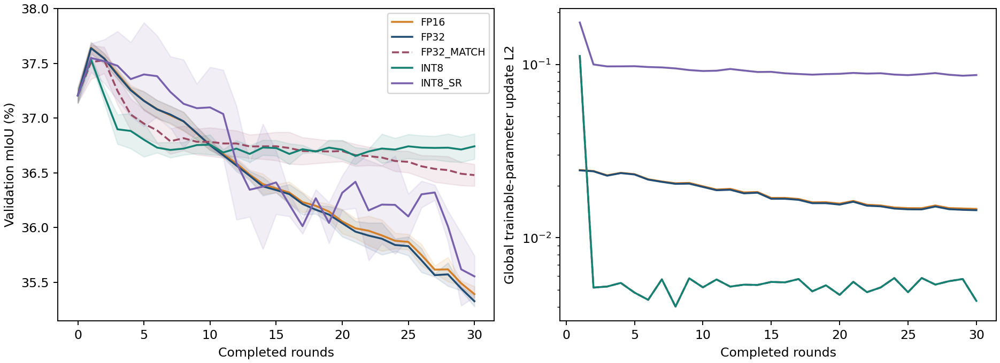
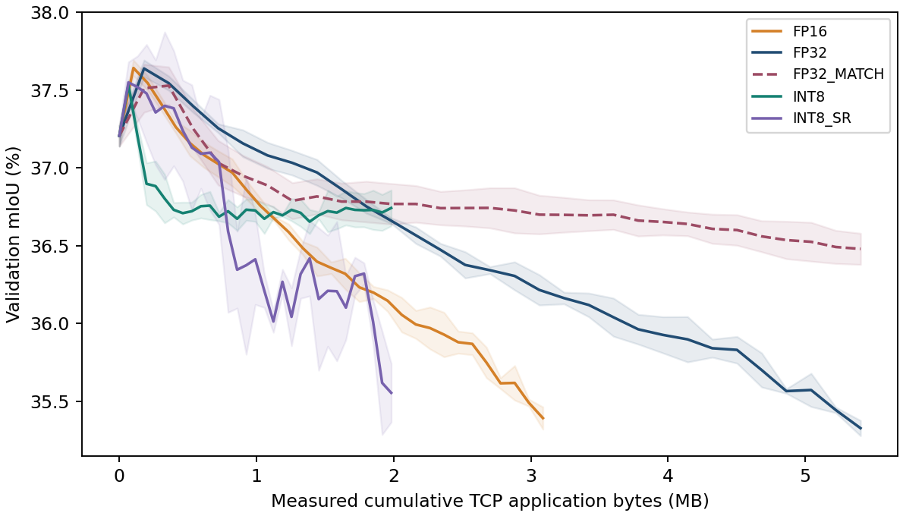

# 전체 가중치 INT8 전송이 2-client FedAvg에 미친 영향

## 결과와 해석

같은 시드끼리 비교한 30라운드 mIoU에서 최근접 INT8의 FP32 대비 차이는 1.42 ± 0.07%p였다. 순수 FP32에서도 매 라운드 학습 파라미터와 BN 통계의 글로벌 업데이트 L2를 각각 INT8과 같게 만들면 FP32 기본 대비 1.15 ± 0.06%p의 변화가 관측됐다. INT8과 이 크기 대조군 간 남은 차이(INT8 − 대조군)는 0.26 ± 0.09%p였다.

초기 매핑이 일어나는 1라운드에서 INT8 파라미터 이동은 0.11179였고 FP32는 0.02447였다. 이후 2~30라운드의 평균 이동은 INT8에서 FP32보다 70.5% 작았다. 따라서 초기 양자화 이동과 이후 로컬 적응이 둔해진 현상은 구분해 해석했다.

세 시드는 동일한 사전학습과 분할을 공유한다. 아래 ±는 세 시드의 표본 표준편차다. 2~30R 지표는 먼저 각 실행 안에서 평균했다.

|전송·집계|0R mIoU %|30R mIoU %|0→30 %p|30R TCP MB|1R 글로벌 L2|2~30R 글로벌 L2|2~30R BN L2|최종 파라미터 이동¹|
|---|---|---|---|---|---|---|---|---|
|FP32|37.21 ± 0.07|35.33 ± 0.05|-1.88 ± 0.09|5.404 ± 0.000|0.02447 ± 0.00080|0.01784 ± 0.00005|0.07428 ± 0.00090|0.4398 ± 0.0004|
|FP16|37.21 ± 0.07|35.39 ± 0.07|-1.82 ± 0.11|3.088 ± 0.000|0.02459 ± 0.00082|0.01803 ± 0.00005|0.07430 ± 0.00078|0.4394 ± 0.0004|
|INT8|37.21 ± 0.07|36.74 ± 0.12|-0.46 ± 0.12|1.982 ± 0.000|0.11179 ± 0.00015|0.00526 ± 0.00011|0.03557 ± 0.00108|0.1902 ± 0.0024|
|INT8_SR|37.21 ± 0.07|35.55 ± 0.19|-1.65 ± 0.15|1.982 ± 0.000|0.17439 ± 0.00144|0.09106 ± 0.00038|0.08216 ± 0.00274|0.6690 ± 0.0061|
|FP32_MATCH|37.21 ± 0.07|36.48 ± 0.10|-0.73 ± 0.15|5.404 ± 0.000|0.11179 ± 0.00015|0.00526 ± 0.00011|0.03557 ± 0.00108|0.2417 ± 0.0032|

¹ 최종 체크포인트와 같은 시드의 시작 체크포인트 간 L2 거리다. 라운드별 이동 거리의 합과 구분했다.



## 업데이트가 바뀌는 단계

기존 전송 단위는 양방향 전체 state_dict다. 서버 상태 G를 보낸 뒤 클라이언트에 복원된 공통 상태를 D, 각 client의 학습 직후를 Lᵢ, 업로드를 복원한 상태를 Uᵢ라고 두었다. 학습 이동은 Lᵢ−D, 업링크 오차는 Uᵢ−Lᵢ, 복원 후 로컬 이동은 Uᵢ−D, 다운링크 오차는 D−G다. 글로벌 이동은 다음 서버 상태에서 G를 뺀 값이다. 학습 파라미터(BN affine 포함), BN running mean/variance, 전체 부동소수 상태를 각각 벡터화했다. 정수 batch counter는 L2와 cosine에서 제외했다. 0R의 전송량과 초기점 거리는 0이고 업데이트가 필요한 지표는 결측으로 남겼다.

|전송·집계|클라이언트 학습 L2|업링크 오차/학습 L2|학습 이동 간 cos|복원 후 이동 간 cos|글로벌 vs 평균 학습 이동 cos|1/2번 평균 local loss¹|
|---|---|---|---|---|---|---|
|FP32|0.02526 ± 0.00014|0.000 ± 0.000|-0.013 ± 0.014|-0.013 ± 0.014|1.000 ± 0.000|0.502 / 0.537|
|FP16|0.02527 ± 0.00014|0.105 ± 0.000|-0.010 ± 0.014|-0.011 ± 0.014|0.984 ± 0.000|0.502 / 0.539|
|INT8|0.02874 ± 0.00015|1.016 ± 0.000|0.408 ± 0.020|0.672 ± 0.056|0.019 ± 0.002|0.749 / 1.024|
|INT8_SR|0.02530 ± 0.00014|3.526 ± 0.013|-0.017 ± 0.017|-0.003 ± 0.005|0.192 ± 0.001|0.500 / 0.538|
|FP32_MATCH|0.02635 ± 0.00003|0.000 ± 0.000|0.176 ± 0.024|0.176 ± 0.024|1.000 ± 0.000|0.533 / 0.599|

¹ loss는 1~30라운드의 점유 복셀 평균 cross-entropy다. 나머지 표 항목은 2~30라운드이고, 두 client 지표는 동일 가중치로 평균했다. 노름이 0인 벡터와의 코사인은 결측이다.

최근접 INT8에서 클라이언트당 학습 이동의 평균 L2는 0.02874, 업링크 오차/학습 이동의 평균 비는 1.016였다. 글로벌 이동과 평균 학습 이동 사이의 코사인은 FP32 1.000, INT8 0.019였다. 크기뿐 아니라 방향도 달라졌다. 성능과 크기의 단순 상관보다 아래 개입 대조를 우선했다.

## 크기 대조·반올림·BN 교차 평가

최근접 INT8의 업링크 스케일을 고정해 D와 Lᵢ를 각각 정수화했다. 2~30R에 로컬 학습으로 바뀐 파라미터 중 같은 정수 bin에 남은 비율은 클라이언트·라운드·시드 평균 100.0000%, 최솟값 100.0000%였다. 스케일 자체는 텐서의 최댓값과 함께 바뀌므로 같은 정수 코드가 같은 복원 실숫값을 보장하지 않는다. 이 관측은 작은 개별 학습 이동이 업링크에서 소실되는 경로를 보여 준다.

FP32_MATCH는 같은 시드·같은 라운드의 INT8 기록에서 학습 파라미터 L2와 BN 통계 L2 두 값만 읽었다. 자신의 FP32 FedAvg 방향은 유지하고 두 그룹의 이동 크기만 각각 맞췄다. 그룹별 배율은 1을 넘을 수 있다. 크기 목표에는 검증 결과나 test 점수를 사용하지 않았다. 정수 counter는 모든 조건에서 기존 집계 규칙을 유지했다. 이 대조군은 기전을 확인할 때 사용하는 사후 대조다.

INT8 목표 대비 FP32_MATCH의 라운드별 파라미터 L2 최대 절대 차이는 1.04e-08였다. FP32 전달만으로 상당 부분 유사한 최종 성능을 보인 것은 작은 폭의 글로벌 적응이 검증 성능 유지에 기여한다는 설명을 지지한다. 남은 차이에는 업데이트 방향, 하향 전송 오차, 이후 로컬 궤적 등 여러 효과가 함께 들어간다. 단일 요인의 독립 기여율로 환산하기 어렵다.

FP16은 부동소수 전송 상태를 IEEE binary16으로 반올림한 뒤 FP32로 복원했다. 기존 INT8은 텐서별 FP32 스케일 max(abs(x))/127과 torch.round(정확히 절반이면 짝수)를 사용한다. 영 텐서 스케일은 1이다. INT8_SR은 같은 스케일·직렬화에 인접 두 정수로 확률 반올림을 적용했다. 위쪽 정수의 확률은 소수부이고, 시드·라운드·통신 방향별 난수열을 고정했다. 다운링크는 한 번 양자화해 두 클라이언트에 같은 payload를 보냈다. INT8_SR − 최근접 INT8의 30R 차이는 -1.19 ± 0.12%p였다. 이는 이 설정에서 반올림 정책이 학습 궤적에 영향을 줬다는 비교다.

BN의 역할을 분리해 보기 위해 같은 시드·라운드에서 학습 파라미터를 고정하고 FP32와 INT8의 running mean/variance만 교차 장착해 공통 검증을 다시 평가했다. 체크포인트 선택이나 추가 학습은 하지 않았다.

|파라미터|BN 통계|1R mIoU %|10R|20R|30R|
|---|---|---|---|---|---|
|FP32|FP32|37.64 ± 0.05|36.75 ± 0.04|36.04 ± 0.12|35.33 ± 0.05|
|FP32|INT8|37.64 ± 0.07|37.22 ± 0.24|36.93 ± 0.05|36.34 ± 0.12|
|INT8|FP32|37.54 ± 0.03|35.86 ± 0.12|35.31 ± 0.15|35.24 ± 0.19|
|INT8|INT8|37.53 ± 0.03|36.76 ± 0.09|36.71 ± 0.09|36.74 ± 0.12|

30R FP32 파라미터에 INT8 BN 통계를 적용한 변화는 +1.01%p였고, INT8 파라미터에 FP32 통계를 적용한 변화는 -1.50%p였다. 이 교차 평가는 최종 모델이 BN 통계 선택에 민감함을 보여 준다. BN이 훈련 중 파라미터에 미친 효과까지 분리하지는 못한다. [각 시드의 교차 평가](bn_swap.csv)

## 조기 중단과 동기화 비용

장면 12의 공통 검증 mIoU를 매 라운드 평가하고, 0R을 포함해 최고값이 엄격히 개선되지 않은 상태가 연속 3회이면 중단한다. 서버에는 그때까지 최고였던 모델을 복원한다. patience=3과 min_delta=0은 Phase 3 실행 전에 고정했다. 이전 실험에서 이 장면을 반복 사용했으므로 검증 점수에는 선택 편향이 있을 수 있다.

각 셀은 mIoU % / 실제 누적 MB의 세 시드 평균이다. ‘사후 최고’의 MB는 그 모델이 처음 생긴 시점까지로, 최고였음을 확인하려면 30라운드를 관측해야 한다. 온라인 중단의 MB에는 개선을 기다린 라운드의 비용도 포함한다.

|전송·집계|0R|사후 최고|10R|20R|30R|온라인 복원 / 소비 MB|온라인 중단 R → 복원 R (42·43·44)|
|---|---|---|---|---|---|---|---|
|FP32|37.21 / 0.000|37.64 / 0.180|36.75 / 1.801|36.04 / 3.602|35.33 / 5.404|37.64 / 0.720|4→1, 4→1, 4→1|
|FP16|37.21 / 0.000|37.64 / 0.103|36.76 / 1.029|36.05 / 2.059|35.39 / 3.088|37.64 / 0.412|4→1, 4→1, 4→1|
|INT8|37.21 / 0.000|37.53 / 0.066|36.76 / 0.661|36.71 / 1.321|36.74 / 1.982|37.53 / 0.264|4→1, 4→1, 4→1|
|INT8_SR|37.21 / 0.000|37.64 / 0.154|37.10 / 0.661|36.32 / 1.321|35.55 / 1.982|37.64 / 0.352|4→1, 8→5, 4→1|
|FP32_MATCH|37.21 / 0.000|37.56 / 0.300|36.78 / 1.801|36.70 / 3.603|36.48 / 5.404|37.56 / 0.841|5→2, 5→2, 4→1|



30라운드 궤적에서 온라인 정책을 순차 재생했고, 별도 프로세스 실험에서 시드 42·INT8을 실제로 중단했다. Client 2의 2라운드 응답 직전 연결을 끊어 캐시한 응답을 재사용했다. 4라운드에서 중단해 1라운드 모델을 복원했고 모든 텐서가 기준 실행과 일치했다. 재시도를 포함한 동기화 비용은 280,754 B, 종료 제어 프레임은 546 B였다.

TCP 표에는 두 방향의 모델 프레임, 메타데이터와 최초 연결 바이트를 포함했다. 종료 제어 프레임, 최선 모델의 추후 배포, IP 계층은 표의 동기화 비용에 포함하지 않았다. Phase 2와 프레임 메타데이터가 달라 절대 바이트 수가 소폭 달라진다. FP32와 최근접 INT8의 세 시드 모두 30개 라운드 점수와 마지막 가중치가 Phase 2와 일치했다.

## 데이터·배포 인터페이스

linuxserver2의 RTX A6000 한 장에서 독립된 두 클라이언트를 순차 학습했다. 세 시드는 장면 13 사전학습 체크포인트와 동일 분할을 공유한다. 시드별 미세조정 시작 상태는 기존 파일을 재사용했고 클라이언트 학습은 Non-IID 장면 3·4 각 96패치, batch 24, local epoch 1, 기존 AMP·AdamW 설정이다. 검증은 장면 12의 144패치만 사용했다. WMSC는 열지 않았다. 기존 파일 524개의 해시를 보존했다. 이 결과는 단일 검증 장면과 한 쌍의 클라이언트에 대한 관측이다.

서버에는 시작 체크포인트와 validation/patches.npz, 각 클라이언트에는 자기 역할의 patches.npz만 배포한다. 클라이언트 실행에는 다른 장면 캐시나 전체 split 파일이 필요하지 않다. 입력 번들은 role, patch별 bounds, 점유 XYZ와 RGB-16을 포함하며 학습 시 Common 6 labels를 사용한다. 추론 출력은 입력 복셀 순서의 클래스 ID다. 측정용 로컬 가중치 기록은 연구 실행에서만 활성화했다. 두 클라이언트의 양자화 전 벡터는 실험 뒤 오프라인에서 대조했으며 FedAvg 서버에 추가 전송하지 않았다.

서버의 server.pt에는 마지막 커밋, 최고 가중치와 정책 상태가 들어가고 best.pt에는 배포할 모델이 저장된다. 클라이언트의 last.pt에는 마지막 요청 ID·부모 해시, 응답 payload와 로컬 체크포인트가 저장된다. 같은 작업 디렉터리와 인자로 재시작하면 완료 라운드를 이어가고 같은 부모의 중복 요청에는 저장된 응답을 돌려준다. TCP 예제는 신뢰된 시험망 또는 터널을 전제로 하며 기본 주소는 loopback이다. 실기체·무선 링크·보드 전력·실시간 성능은 평가 범위 밖이다.

아래는 프로젝트 루트의 별도 터미널 세 개에서 같은 호스트로 구동하는 예다. 먼저 운영자가 임의의 16바이트 파일을 생성해 세 역할에 동일한 내용으로 제공한다. 개별 보드에서는 각 보드의 로컬 번들 경로와 서버 주소를 지정한다.

```bash
P=results/distributed_ai_phase3
# 세 터미널에서 같은 P와 TOKEN 경로를 설정한다.
TOKEN="$P/demo.token"
# 최초 한 번만 생성한다.
.venv-gpu/bin/python -c 'import os,secrets,sys; f=os.fdopen(os.open(sys.argv[1],os.O_CREAT|os.O_EXCL|os.O_WRONLY,0o600),"wb"); f.write(secrets.token_bytes(16)); f.close()' "$TOKEN"

.venv-gpu/bin/python -m federated.fl_server --start results/distributed_ai/starts/s42_p0.pt --validation "$P/bundles/validation/patches.npz" --mode INT8 --patience 3 --work "$P/demo/server" --token-file "$TOKEN"
.venv-gpu/bin/python -m federated.uav_client --id 1 --data "$P/bundles/client1/patches.npz" connect --work "$P/demo/client1" --token-file "$TOKEN"
.venv-gpu/bin/python -m federated.uav_client --id 2 --data "$P/bundles/client2/patches.npz" connect --work "$P/demo/client2" --token-file "$TOKEN"
# best.pt를 추론할 클라이언트에 복사한 뒤 실행한다.
.venv-gpu/bin/python -m federated.uav_client --id 1 --device cpu --data "$P/bundles/client1/patches.npz" infer --checkpoint "$P/demo/server/best.pt" --output "$P/demo/predictions.npy"
```

연구 실행과 보고서는 아래 명령으로 재현한다. 각 run 디렉터리의 완료 표시가 있는 실험은 재사용한다.

```bash
.venv-gpu/bin/python -m experiments.distributed_ai_phase3
.venv-gpu/bin/python -m experiments.phase3_analysis
.venv-gpu/bin/python -m experiments.phase3_report
```

[라운드별 업데이트·오차·local loss·바이트](update_norms.csv) · [시드별 비교](quantization_analysis.csv) · [중단 정책별 실제 소비·선택 모델](early_stopping.csv) · [프로토콜과 해시](protocol.json)
