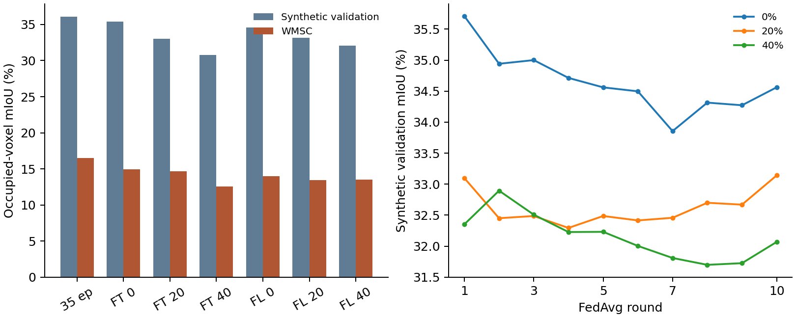

# STPLS3D Native Sparse 3D CNN 재구현

## 재현 범위

발표자료에 기록된 0.3 m, RGB-16, XY 32×32, stride 32, 가변 Full-Z, Common 6, AdamW, 35 epoch, batch 24를 적용했다. 발표자료의 WMSC Accuracy 85.34%, mIoU 48.86%, Macro F1 61.20%는 과거 Synthetic_v1·v2·v3 학습 결과다. 이번에는 로컬 Synthetic_v3 네 장면을 사용했고, 원 발표의 전체 레이어 명세·초기 가중치·복셀/점 단위 평가 세부사항은 제공되지 않았다.

## 데이터와 전처리

|역할|원본 장면|점|점유 복셀|XY 패치|전체 Z 셀|
|---|---|---:|---:|---:|---:|
|central|13_points_GTv3.ply|20,992,190|4,175,210|2,704|204|
|validation|12_points_GTv3.ply|20,903,953|4,226,451|2,704|98|
|drone_a|3_points_GTv3.ply|20,298,964|4,081,099|2,704|104|
|drone_b|4_points_GTv3.ply|21,619,511|4,475,907|2,704|164|
|external|WMSC_points.ply|9,977,764|2,139,806|1,271|167|

모든 비어 있지 않은 XY 패치를 사용했다. 장면 원점은 floor(minXYZ / 0.3) × 0.3, 복셀은 floor((XYZ − origin) / 0.3)으로 계산했다. 캐시는 점유 복셀의 패치 내 X·Y와 장면 기준 Z, XY 타일 주소, raw 레이블, float32 대표 RGB, 장면 원점과 크기를 보존한다. 원본 점 좌표를 float64로 승격한 뒤 경계와 중심 거리를 계산했다.

복셀의 raw class를 먼저 다수결로 정하고 이후 Common 6으로 변환했다. 색상은 세 채널을 각각 16단계로 나눈 4,096개 결합 bin 중 최빈 bin의 원본 RGB 평균이다. 두 투표는 독립이다. 동률 후보 중 중심에 가장 가까운 점이 속한 후보를 선택하고, 거리까지 같으면 원본 PLY에 먼저 나온 점을 선택했다.

Ground 0·15·18·19, Building 1·7·9·10·13·17, Tree 2·3·4, Car 5·6·8, Light pole 11·12, Fence 14로 매핑했다. 입력에서 미정의 raw ID를 만나면 변환을 중단한다. 공식 표에 16은 정의되어 있지 않다. [STPLS3D 공식 레이블 표](https://github.com/meidachen/STPLS3D#25-semantic-annotations)

## 모델과 학습

NVIDIA RTX A6000, Python 3.11.3, PyTorch 2.8.0+cu126, CUDA 런타임 12.6에서 실행했다. spconv·MinkowskiEngine·TorchSparse는 설치되어 있지 않았다. PyTorch의 CUDA gather, 행렬곱, index_add로 중심 및 ±X·±Y·±Z에서 두 끝이 모두 점유된 좌표 쌍만 계산했다. 빈 공간을 포함하는 3D 특징 격자를 만들지 않는다.

레이어 수·폭, 스텐실, 풀링, 입력 정규화 및 학습률은 재구현 선택이다. 입력은 대표 RGB/255의 3채널이다. 7점 submanifold convolution(3→16), 2×2×2 점유 자식 평균, coarse sparse convolution(16→32), parent index로 각 fine 좌표에 coarse 특징 복원, 원본 skip 16채널과 결합, fine sparse convolution(48→16), pointwise linear(16→6) 순서다. 세 sparse 블록은 BN·ReLU를 사용한다. 출력의 i번째 행은 입력의 i번째 점유 복셀에 대응한다.

기존 Dense U-Net은 occupancy·높이·RGB 5채널 고정 32³ 격자를 사용하며 3×3×3 Conv3d와 max pool, nearest interpolation을 적용한다. 두 모델의 입력, 연산, 학습 범위, 외부 평가 복셀 집합이 달라 기존 Dense 표의 수치로 구조 효과를 분리할 수 없다.

seed 42, CUDA 결정적 연산, 혼합정밀도 FP16 및 GradScaler, 평균 cross entropy, AdamW(기본 weight decay 0.01)를 적용했다. 중앙 LR 0.001, 추가 학습과 로컬 LR 0.0001은 각 구간 동안 고정했다. 패치 구성은 고정 시드로 섞고 매 epoch 배치 순서를 바꿨다. 평가와 지연 측정은 FP32다.

## GPU 1 epoch 검증

장면 13 전체의 손실은 1.1106, 학습 시간은 4.94초였다. 별도 장면 12의 Accuracy 70.82%, mIoU 28.06%, Macro F1 35.86%였다. CUDA allocator 기준 시작 874.5 MiB, 최대 998.2 MiB이며 학습·검증의 좌표 쌍 캐시를 포함한다. 학습 시간은 사전 계산한 배치를 사용한 GPU 학습 루프로, PLY 전처리·인덱스 준비·검증은 별도다.

첫 실행에서 CUDA 누산 순서에 따라 재로딩 전후 최대 절대 차이 3.58×10⁻⁷을 관측했다. 결정적 연산을 적용한 실행에서 출력 logits의 모든 값과 검증 mIoU가 정확히 일치했다. 가중치 갱신, FP16 logits·FP32 loss, GPU 역전파, 정수 좌표 정렬을 확인한 후 본학습을 진행했다.

35 epoch 중앙 실험은 smoke와 같은 시드로 처음부터 학습했다. Synthetic 검증 mIoU가 가장 높은 32 epoch를 선택했다. WMSC는 모든 후보 경로와 SHA-256을 저장한 뒤 원본 PLY에서 처리하고 각 후보의 최종 예측을 한 차례씩 수집했다.

## 성능

|모델|Synthetic val mIoU %|WMSC Accuracy %|WMSC mIoU %|WMSC Macro F1 %|
|---|---:|---:|---:|---:|
|baseline|36.07|44.74|16.52|25.46|
|ft0|35.41|36.52|14.95|23.43|
|ft20|33.05|36.42|14.65|23.22|
|ft40|30.79|35.54|12.58|20.11|
|fl0|34.56|31.19|13.99|21.90|
|fl20|33.14|29.65|13.47|21.01|
|fl40|32.07|32.19|13.53|20.99|

각 분할의 전체 점유 복셀에 대한 혼동행렬을 합산했다. 각 클래스 IoU는 TP/(TP+FP+FN), F1은 2TP/(2TP+FP+FN)이다. 정답과 예측이 모두 없는 클래스만 매크로 평균에서 제외한다.

## 구조적 프루닝과 지연

각 sparse 블록 출력 채널의 전체 스텐실·입력 가중치 L1 합으로 순위를 정했다. 가장 작은 채널을 제거하고 BN 파라미터·버퍼, 다음 블록 입력, decoder의 coarse/skip 인덱스, head 입력을 같은 채널로 슬라이스했다. 20%·40%는 요청 비율이며 각 층에서 가장 가까운 정수 폭으로 반올림했다.

|요청 비율|실제 폭|파라미터|MACs/패치|state KiB|캐시 p50/p95 ms|인덱스 포함 p50/p95 ms|
|---:|---|---:|---:|---:|---:|---:|
|0%|(16, 32, 16)|9,526|5,358,240|37.7|6.455 / 7.759|8.559 / 10.113|
|20%|(13, 26, 13)|6,376|3,594,708|25.3|6.465 / 7.981|8.569 / 10.432|
|40%|(10, 19, 10)|3,714|2,111,880|14.8|6.440 / 7.778|8.573 / 10.095|

장면 12에서 점유 복셀 수 중앙값에 해당하는 패치 2344번(1,152개)을 고정했다. batch 1, GPU 상주 입력, warm-up 10회 후 60회 각각 CUDA 동기화한 벽시계 시간이다. 캐시 측정은 좌표 인덱스를 재사용하고, 인덱스 포함 측정은 매번 이를 재구성한다. 두 측정 모두 파일 I/O·호스트 전송은 제외한다. MACs는 실제 fine/coarse edge 수 × 채널 곱 및 분류 head만 합산한다. 패치 밀도와 CPU dispatch에 따라 지연이 달라진다.

|요청 비율|프루닝 직후 val mIoU %|추가 학습 후 val mIoU %|선택 epoch / 5|
|---:|---:|---:|---:|
|0%|36.07|35.41|1|
|20%|28.49|33.05|5|
|40%|22.31|30.79|5|

ft0는 같은 5 epoch 예산의 미프루닝 대조군이다. ft20·ft40도 동일한 Synthetic 검증 기준으로 체크포인트를 선택했다.

## 연합학습

각 구조의 선택된 ft 체크포인트를 두 클라이언트에 복제했다. Drone A와 B는 각각 별도 장면에서 같은 GPU로 순차 학습했다. 매 라운드 클라이언트당 1 epoch를 학습하고 로컬 optimizer를 재설정했다. 기존 fedavg가 패치 수로 가중평균하며, 두 장면의 패치 수가 같아 각 가중치는 ½이다. BN 통계도 평균하고 batch counter는 최댓값을 사용했다. 10라운드의 고정 최종 모델을 평가했다.

|비율|시작 → 10R WMSC mIoU %|10R Synthetic val mIoU %|양방향 누적 전송 MiB|
|---:|---:|---:|---:|
|0%|14.95 → 13.99|34.56|1.474|
|20%|14.65 → 13.47|33.14|0.990|
|40%|12.58 → 13.53|32.07|0.580|

전송량은 각 라운드에 상태 텐서를 두 번 내려보내고 두 번 회수한 비압축 payload 계산값이다. 로컬 시뮬레이션으로 네트워크 지연·프로토콜 헤더는 측정 대상에서 제외했다.

## 클래스별 WMSC IoU

|모델|Ground|Building|Tree|Car|Light pole|Fence|
|---|---:|---:|---:|---:|---:|---:|
|baseline|37.02|12.61|38.52|4.76|6.18|0.00|
|ft0|24.20|11.26|43.15|5.90|5.22|0.00|
|ft20|24.27|12.41|40.25|4.66|6.31|0.00|
|ft40|21.34|15.67|35.30|2.08|1.08|0.00|
|fl0|14.18|12.97|44.37|12.26|0.14|0.00|
|fl20|12.39|12.97|45.21|9.84|0.42|0.00|
|fl40|14.63|13.97|45.39|7.20|0.00|0.00|



## 측정 해석과 검증

35 epoch 실험에서 선택한 기준 모델은 WMSC Ground 1,418,727개 중 626,731개(44.2%)를 Building으로 예측했다. Fence는 정답 16,284개 중 올바른 예측이 0개였다. 이는 현재 외부 성능에 기여한 관측 오류이며, 과거 발표와의 차이를 단일 원인으로 분리할 수 없다.

원본 PLY와 별도로 대조한 복셀 480개의 raw 다수결·RGB-16 평균이 일치했다. 다섯 장면의 전체 점유 좌표 19,098,473개에서 XY 타일·좌표의 중복 및 장면 Z 범위를 확인했다. [캐시 대조 기록](cache_audit.json)

학습 도중부터 5초 간격으로 기록한 장치 전체 GPU 사용률은 중앙값 12%, 최댓값 34%였다. 표본 중 장치 전체 메모리 최댓값은 2,527 MiB였다. PyTorch allocator peak와 측정 범위가 다르다. [장치 표본](gpu_samples.csv)

20% 모델은 파라미터가 33.1%, 기준 패치 MACs가 32.9% 줄었다. 인덱스 구성을 포함한 p50 지연의 원본 대비 변화는 +0.1%였다.

40% 모델은 파라미터가 61.0%, 기준 패치 MACs가 60.6% 줄었다. 인덱스 구성을 포함한 p50 지연의 원본 대비 변화는 +0.2%였다.

이번 측정은 단일 시드·단일 외부 장면이다. 과거 결과와 같은 조건으로 비교하려면 Synthetic_v1·v2·v3의 당시 장면 목록, 모델 폭과 연산 명세, WMSC 평가 단위와 채점 코드를 확보해야 한다.

## 재실행과 산출물

프로젝트 루트에서 다음 순서로 실행한다. 학습 명령은 새 출력 디렉터리를 요구한다.

```bash
.venv-gpu/bin/python -m datasets.fullz data/s2r_v3/*_points_GTv3.ply
.venv-gpu/bin/python -m pytest -q
.venv-gpu/bin/python -m experiments.sparse_reproduction --out results/sparse_3dcnn_reproduction/new_run
.venv-gpu/bin/python -m experiments.sparse_audit results/sparse_3dcnn_reproduction/new_run
.venv-gpu/bin/python -m experiments.sparse_report results/sparse_3dcnn_reproduction/new_run
```

[프로토콜과 데이터 해시](protocol.json) · [GPU smoke](smoke.json) · [35 epoch 학습 기록](baseline_training.csv) · [프로파일](profiles.csv) · [프루닝](pruning.csv) · [FL 라운드](federated.csv) · [확정된 모델 해시](frozen.json) · [전체 지표](comparison.csv) · [혼동행렬과 클래스별 지표](evaluation.json)
