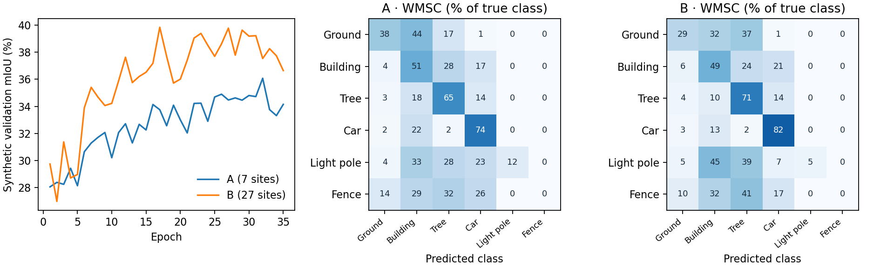
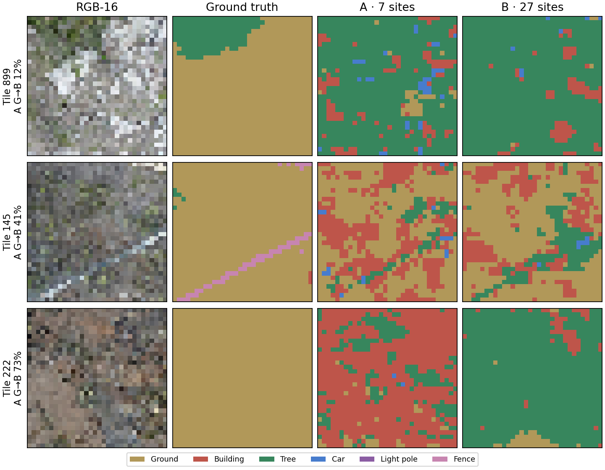

# STPLS3D Full-Z Sparse CNN 성능 진단

중앙 학습 데이터를 고정하고 7점 스텐실(A)을 27점(B)으로 바꿨을 때 mIoU 변화는 Synthetic validation **+3.76%p**, WMSC **-2.65%p**였다. 과거 발표의 WMSC mIoU는 48.86%이고 이번 A·B는 각각 16.52%, 13.87%였다.

## 확인된 차이

### 장면, 학습량과 클래스 분포

발표 기록의 WMSC 지표는 Accuracy 85.34%, mIoU 48.86%, Macro F1 61.20%다. 과거 Synthetic_v1·v2·v3의 train 145,329패치와 validation 37,837패치에 대해 장면별 배정이나 클래스별 복셀 수는 확보하지 못했다. WMSC는 두 실험 모두 1,271패치다. 같은 패치 수만으로 개별 복셀의 정답 및 채점 방식까지 일치하는지는 판단할 수 없다.

|현재 역할|장면|XY 패치|점유 복셀|Ground|Building|Tree|Car|Light pole|Fence|
|---|---|---|---|---|---|---|---|---|---|
|central|13_points_GTv3|2704|4,175,210|1,983,861|1,690,284|325,878|147,834|20,464|6,889|
|validation|12_points_GTv3|2704|4,226,451|1,801,134|1,486,167|805,451|105,753|12,593|15,353|
|drone_a|3_points_GTv3|2704|4,081,099|1,993,510|1,457,465|465,914|137,689|18,797|7,724|
|drone_b|4_points_GTv3|2704|4,475,907|2,133,222|1,763,506|430,167|125,634|20,745|2,633|
|WMSC|WMSC_points|1271|2,139,806|1,418,727|238,619|456,018|8,820|1,338|16,284|

v3 보유분은 4개 장면, 10,816패치다. A/B는 13번 전체 2,704패치를 학습하고 12번 전체 2,704패치를 검증했다. 이는 과거 train의 1.86%, validation의 7.15%다. 3·4번은 종전 FL 전용 장면이어서 중앙 모델 비교에서는 제외했다. 장면 13의 Ground 비율은 47.52%이며, WMSC는 66.30%다. [분할별 비율과 개수](scene_class_distribution.csv)

|버전|ZIP 내 PLY|로컬 PLY|전체 원본 GB|추가 원본 GB|
|---|---|---|---|---|
|v1|14|0|11.42|11.42|
|v2|24|0|12.44|12.44|
|v3|25|4|10.95|9.53|

프로젝트와 사용자 작업공간에 v1·v2 PLY가 없었다. 기존 배포 ZIP의 중앙 디렉터리에서 보관한 파일 목록을 사용했다. v1·v2 38개의 원본 합은 23.86 GB, 빠진 v3까지 포함하면 33.39 GB다. ZIP 전체 크기는 37.22 GB, 서버 사용자 quota 잔여는 측정 당시 41.09 GB (38.27 GiB)였다. 추가 파일 크기는 압축 해제 후 원본 기준이며 Full-Z 캐시와 임시 공간은 별도다. 이번 다운로드는 0바이트다. [파일별 경로·크기](archive_inventory.csv) · [quota 실측](storage.json)

### 실제 입력과 네트워크

캐시의 원본 대표색은 RGB 각 채널의 폭 16인 결합 bin 중 최빈 bin에서 평균한 float32다. 실제 encoder에 들어간 연속 특징은 R/255, G/255, B/255 순서의 세 채널이다. 보유한 Synthetic 네 장면을 검사했을 때 각 채널 원본 범위는 [0,255], 정규화 범위는 [0,1]이었다. GPU 입력 후크로 텐서 동일성을 확인했다. CPU/GPU float32 나눗셈 간 최대 차이 5.96×10⁻⁸을 관측해 1 ULP 허용으로 대조했다. 정수 좌표와 레이블은 정확히 일치했다.

점유는 행 존재로 표현한다. 좌표는 [batch, local X, local Y, scene Z]이며 X·Y는 0–31, Z는 원점 기준 정수로 장면 13에서 0–203, 장면 12에서 0–97, WMSC에서 0–166이다. 좌표는 stencil, pooling, skip/upsampling 정렬에 사용한다. encoder 특징에 occupancy 상수나 local XYZ, 정규화 높이를 연결하는 경로는 없다. 과거 발표의 채널 명세나 입력 텐서가 없어 해당 차이의 존재는 미확인이다. [GPU 입력 검증](smoke.json) · [캐시·환경 설정](protocol.json)

A는 한 번의 합성곱에서 중심과 ±X·±Y·±Z를 연결한다. B는 모서리·꼭짓점을 포함한 3×3×3의 27개 오프셋마다 별도 가중치를 두고, 실제 점유 쌍에서만 곱한다. FP64 작은 격자에서 PyTorch dense Conv3d와 같은 가중치로 forward 및 입력·가중치 gradient를 대조했다. 두 모델 모두 점유 자식 평균, 정확한 부모 인덱스 업샘플링, coarse/skip concat을 공유한다.

|레이어|채널|A params|B params|입력 bbox|A 최대 복셀|B 최대 복셀|
|---|---|---|---|---|---|---|
|fine sparse convolution + BN/ReLU|3→16|368|1,328|3³|7|27|
|점유 평균 pool (stride 2)|16→16|0|0|4³|32|64|
|coarse sparse convolution + BN/ReLU|16→32|3,648|13,888|8³|152|512|
|parent gather + skip concat|32+16→48|0|0|8³|152|512|
|fine sparse convolution + BN/ReLU|48→16|5,408|20,768|10³|336|1000|
|점별 linear + bias|16→6|102|102|10³|336|1000|

총 학습 파라미터는 A 9,526개, B 36,086개다. 표의 수용영역은 eval 모드, 패치 경계에서 떨어진 완전 점유 격자에서 출력 한 점이 참조할 수 있는 고유 입력 위치 수다. 출력 최장 축 방향 범위는 둘 다 10셀(3.0 m 폭)이고 pooling 위상에 따라 시작점이 이동한다. train 모드 BN의 배치 통계는 이 공간 계산에서 제외했다.

장면 12의 고정 48패치에서 복셀 1,536개에 대해 점유 그래프를 역추적했다. 직접 연결된 이웃 수 평균은 A 3.77, B 8.40였다. 최종 출력이 참조할 수 있는 실제 입력 복셀 수의 중앙값은 A 63, B 100였고 1,457개 위치에서 B가 더 넓었다. 이는 구조적으로 가능한 경로 수이며 학습된 기여도의 측정값과는 구별된다. [공간 수용영역 측정](spatial_support.json)

## 통제 비교 결과

linuxserver2의 NVIDIA RTX A6000, /home/gpu_01/voxel_uav_project/.venv-gpu/bin/python, Python 3.11.3, PyTorch 2.8.0+cu126, CUDA 12.6를 사용했다. 3패치 GPU smoke에서 각 모델의 AMP forward/backward, 가중치 갱신, 좌표·skip과 checkpoint 복원 후 정확한 logits 일치를 확인했다. 본학습은 둘 다 무작위 초기화, seed 42, batch 24, 35 epoch, AdamW LR 0.001, weight decay 0.01, 가중치 없는 CE, FP16 AMP이다. seed와 초기화 규칙은 같고 파라미터 텐서 크기는 구조에 따라 다르다. 패치 배정·배치 순서·optimizer step 시도 3,955회·패치 방문 94,640회가 같다. 중앙 13번과 검증 12번은 서로 독립된 장면이다.

각 모델의 Synthetic validation mIoU가 가장 높은 epoch를 채택하고 동률은 이른 epoch를 택했다. 두 체크포인트와 해시를 확정한 뒤 WMSC를 각 1회 FP32 추론해 좌표순 예측을 저장했다. 이후 오류 분석과 사례 시각화는 저장된 예측을 사용했다. 기존 WMSC 결과가 연구 질문의 배경이었고 같은 WMSC를 이전에 여러 차례 분석했다. 이번 실행에서 WMSC로 하이퍼파라미터나 체크포인트를 선택하지 않았지만, 독립된 신규 외부 시험으로 해석하기에는 한계가 있다. [확정 모델·해시](frozen.json)

|모델|선택 epoch|검증 Acc|검증 mIoU|검증 F1|WMSC Acc|WMSC mIoU|WMSC F1|
|---|---|---|---|---|---|---|---|
|A|32|72.54%|36.07%|46.59%|44.74%|16.52%|25.46%|
|B|17|77.37%|39.83%|49.73%|40.11%|13.87%|22.43%|

A의 재학습 체크포인트는 이전 7점 기준 모델과 모든 가중치·BN 버퍼 값이 정확히 일치했다. [A 재현 대조](A_replay.json)

|모델·분할|Ground|Building|Tree|Car|Light pole|Fence|
|---|---|---|---|---|---|---|
|A val|58.86%|50.17%|74.60%|27.54%|5.25%|0.00%|
|A wmsc|37.02%|12.61%|38.52%|4.76%|6.18%|0.00%|
|B val|67.24%|54.86%|80.07%|31.21%|5.59%|0.00%|
|B wmsc|28.29%|15.46%|30.75%|5.00%|3.71%|0.00%|

모든 점유 복셀 예측이 모인 6×6 혼동행렬에서 Accuracy=ΣTP/N, 클래스별 IoU=TP/(TP+FP+FN), F1=2TP/(2TP+FP+FN)을 구했다. mIoU·Macro F1은 각각 클래스 산술평균이다. 정답과 예측 모두 없는 클래스는 해당 평균에서 제외하며, 한쪽만 있으면 0이다. CE의 기본 ignore_index는 −100이지만 입력에 무시 레이블은 0개다. 빈 복셀에는 행 자체가 없고 미정의 raw ID는 변환 단계에서 오류다. [혼동행렬 복셀 수](confusion.csv) · [클래스별 분모와 IoU](class_iou.csv)

|모델|35 epoch 학습 초|학습·검증 배치 준비 초|최대 할당 MiB|MACs/패치|캐시 p50/p95 ms|인덱스 포함 p50/p95 ms|
|---|---|---|---|---|---|---|
|A|143.4|1.1|998.1|5,358,240|6.16/7.83|8.17/9.91|
|B|383.3|2.1|1,488.1|10,594,176|23.44/26.67|28.40/31.83|

학습 시간은 GPU 동기화한 optimizer 루프 합계이고 validation과 준비 시간은 제외했다. peak는 CUDA allocator가 보유한 두 분할의 배치 인덱스를 포함한다. 지연 측정은 validation 2,344번 패치의 1,152개 점유 복셀, batch 1, FP32, warm-up 10회 후 매회 CUDA 동기화해 60회 측정했다.



## Ground → Building 오류

|모델|Synthetic val 오분류/정답 Ground|비율|WMSC 오분류/정답 Ground|비율|
|---|---|---|---|---|
|A|498,498/1,801,134|27.68%|626,731/1,418,727|44.18%|
|B|363,994/1,801,134|20.21%|459,239/1,418,727|32.37%|

WMSC 정답 Ground의 Tree 예측은 A 16.64%에서 B 37.31%로 바뀌었다. A가 Building으로 잘못 부른 동일 복셀 626,731개 중, B는 81,553개를 Ground로 맞혔고 260,120개를 Tree로 분류했다. Ground IoU는 A 37.02%, B 28.29%였다. [정답 Ground에서 A 예측별 B 예측](ground_transitions.csv)

|분할 또는 모델|집단|복셀|평균 R/G/B (0–255)|장면 기준 Z p10/50/90 m|패치 바닥 기준 Z p10/50/90 m|
|---|---|---|---|---|---|
|central|Ground|1,983,861|119.4 / 118.8 / 103.4|1.6 / 6.5 / 7.3|0.0 / 0.0 / 0.6|
|central|Building|1,690,284|104.8 / 101.2 / 105.0|8.2 / 15.1 / 25.1|0.0 / 4.8 / 16.5|
|WMSC|Ground|1,418,727|124.2 / 123.7 / 121.8|9.4 / 23.8 / 39.4|0.3 / 1.5 / 4.2|
|WMSC|Building|238,619|134.1 / 124.0 / 123.2|12.2 / 20.8 / 26.2|0.9 / 3.3 / 7.8|
|A|Ground→Ground|535,215|128.3 / 127.9 / 126.2|12.4 / 21.8 / 37.6|0.3 / 0.9 / 2.7|
|A|Ground→Building|626,731|121.3 / 120.2 / 119.0|6.1 / 23.8 / 37.6|0.3 / 1.5 / 4.5|
|B|Ground→Ground|412,092|123.7 / 123.5 / 121.5|11.5 / 20.6 / 33.4|0.3 / 0.9 / 2.4|
|B|Ground→Building|459,239|128.7 / 128.9 / 128.9|5.8 / 22.1 / 37.6|0.3 / 1.2 / 3.3|

장면 기준 Z는 장면 격자 원점부터 복셀 중심까지의 높이이고, 패치 기준 Z는 같은 XY 패치의 가장 낮은 점유 복셀 중심과의 차이다. 장면 원점의 고도가 서로 달라 절대 월드 Z 비교에는 별도 기준이 필요하다. [RGB 3채널별 분산·분위수 및 월드 Z](rgb_height_statistics.csv)

|WMSC 정답 Ground 하위 집단|복셀|A → Building|B → Building|
|---|---|---|---|
|raw_ground_material · 15|148,355|61.70%|65.14%|
|raw_ground_material · 18|1,017,498|40.17%|28.60%|
|raw_ground_material · 19|252,874|50.00%|28.31%|
|train_RGB_prior_equal · train_ground_more_likely|900,193|37.72%|28.69%|
|train_RGB_prior_equal · train_building_more_likely|518,462|55.39%|38.77%|
|train_RGB_prior_equal · train_unseen_in_both|72|13.89%|18.06%|
|z_above_patch_min_m · 0–0.9|398,852|40.12%|39.07%|
|z_above_patch_min_m · 0.9–3|704,157|43.51%|33.44%|
|z_above_patch_min_m · 3+|315,718|50.77%|21.51%|

색상 집단은 훈련 장면에서 정답 Ground와 Building 각각의 RGB-16 bin 분포를 정규화하여 두 클래스 사전확률을 같게 두고 정의했다. WMSC의 같은 bin이 어느 쪽에서 자주 관측됐는지 비교했다. 예측 모델 입력인 연속 평균 RGB를 진단을 위해 다시 같은 폭으로 묶었다. raw Ground 15·18·19는 각각 Road·Dirt·Grass다. [밝기·높이·원시 재질·색상별 오분류율](ground_error_rates.csv)

WMSC Ground와 학습 Ground의 RGB-16 결합 히스토그램 교집합은 0.370, WMSC Ground와 학습 Building 간 값은 0.427이었다. 두 정규화 빈도 중 작은 값을 4,096개 bin에서 더했다. 0은 완전히 다른 색상 분포, 1은 동일 분포다.

A가 Building으로 오인한 Ground의 패치 바닥 기준 높이 중앙값은 1.5 m, 올바르게 분류한 Ground는 0.9 m였다. 각각의 평균 RGB는 121.3 / 120.2 / 119.0, 128.3 / 127.9 / 126.2였다.

B가 Building으로 오인한 Ground의 패치 바닥 기준 높이 중앙값은 1.2 m, 올바르게 분류한 Ground는 0.9 m였다. 각각의 평균 RGB는 128.7 / 128.9 / 128.9, 123.7 / 123.5 / 121.5였다.

### 실제 패치 사례

정답 Ground가 최소 100개이고 A의 Ground→Building이 한 건 이상인 패치 중, 오분류율 10·50·90분위에 가까운 세 곳을 고정 규칙으로 골랐다. 그림은 위에서 본 가장 높은 복셀만 표시하며 좌표별 표와 오분류율은 전체 높이를 포함한다. 사례 선정은 모델 확정 후 수행했다. [패치별 분모](example_patches.csv) · [개별 복셀의 RGB·Z·정답·A/B 예측](example_voxels.csv)



## 실험으로 지지되는 가설

**이웃 연결 범위와 표현 용량이 영향을 준다.** 동일 학습량에서 27점으로 바꾼 결합 효과는 Synthetic validation +3.76%p, WMSC -2.65%p였다. 실제 입력 경로 수가 늘었고, 파라미터도 3.79배가 됐다. 따라서 차이를 대각선 연결만의 인과 효과로 추정할 수 없다. 이 변경 후에도 과거 WMSC mIoU와 34.99%p 차이가 남는다.

**도메인에 따른 외관과 Ground 혼동이 연관된다.** WMSC의 Ground 중 훈련에서 Building에 더 흔했던 색상 bin의 Ground→Building 비율은 A 55.39%, B 38.77%였다. Ground에 더 흔했던 bin에서는 A 37.72%, B 28.69%였다. 위의 높이·원시 재질 표는 같은 정답 클래스 안에서도 오류율이 어떻게 달라지는지 보여준다. 색상, 재질, 장면 구조와 높이는 함께 변하므로 이 통계만으로 개별 원인을 분리할 수 없다.

## 아직 검증하지 못한 부분과 우선순위

1. **데이터와 split을 먼저 복원한다.** 과거 train/validation의 장면·패치 ID 목록 및 중복 처리 규칙을 확보하고 v1·v2·나머지 v3를 단계별로 추가한다. 고정된 Synthetic 홀드아웃에서 같은 A 모델로 데이터 규모만 바꿔 학습곡선을 비교한다. 현재 한 train 장면과 역사적 패치 수의 격차는 확인됐지만 데이터 확대의 효과 크기는 미측정이다.

2. **원본 입력·채점 계약을 대조한다.** 원본 loader나 대표 입출력 한 배치를 확보해 occupancy, XYZ의 실제 채널 포함 여부, 순서·정규화, 원점·타이브레이크, point/voxel 단위 및 클래스 평균을 직접 확인한다. 필요한 경우 동일 split에서 RGB와 RGB+좌표를 비교한다. occupancy는 모든 점유 행에서 1이므로 독립적인 높이 정보를 주지 않는다.

3. **구조와 외부 일반화를 분리해 검증한다.** 원본 layer·폭·다운샘플 단계가 확인되면 이를 맞추고, 27점 모델의 폭을 줄여 파라미터 수를 맞춘 대조와 복수 seed를 추가한다. 최종 비교 전에 사용 이력이 없는 실측 장면과 지표를 미리 확정한다. 지금은 단일 seed, 단일 WMSC 장면이며 과거 점수의 재현을 보장할 근거는 없다.

## 재실행

프로젝트 루트에서 새 출력 경로로 실행한다. 학습 진입점은 기존 출력 경로가 있으면 중단한다. A/B 동결 후 두 번째 명령이 WMSC 평가를 수행한다.

```bash
.venv-gpu/bin/python -m experiments.sparse_diagnosis --out results/sparse_diagnosis/repeat
.venv-gpu/bin/python -m experiments.sparse_external results/sparse_diagnosis/repeat
.venv-gpu/bin/python -m experiments.sparse_error_analysis results/sparse_diagnosis/repeat
.venv-gpu/bin/python -m experiments.sparse_reach results/sparse_diagnosis/repeat
.venv-gpu/bin/python -m experiments.sparse_diagnosis_report results/sparse_diagnosis/repeat
```
